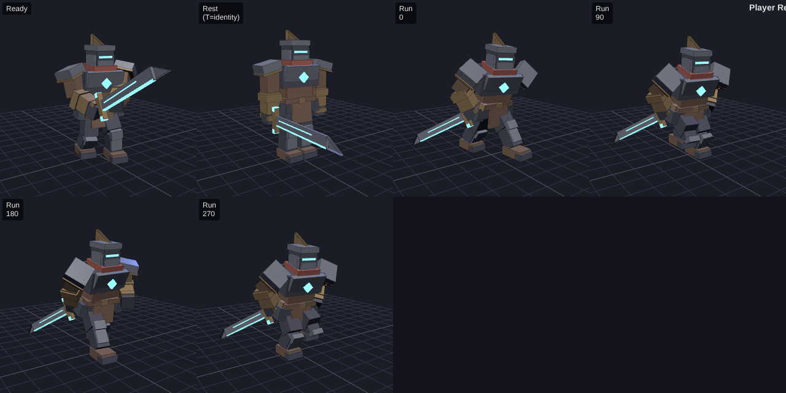
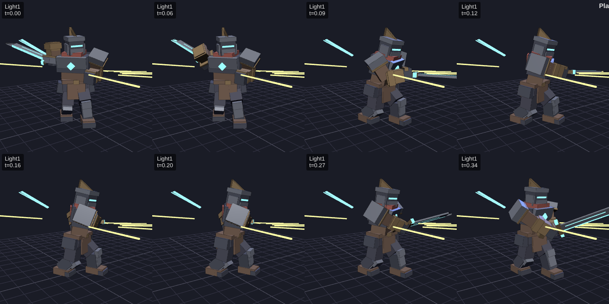
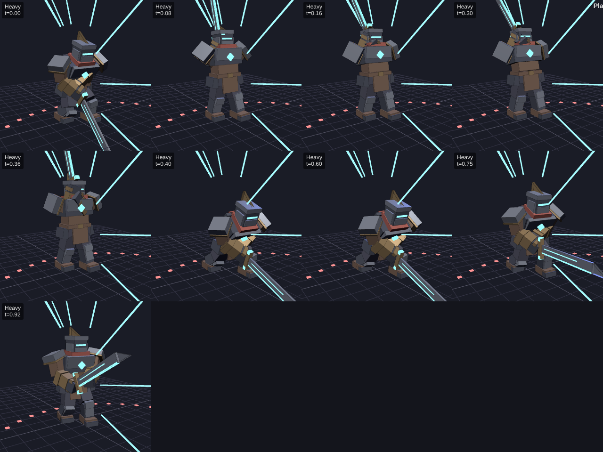
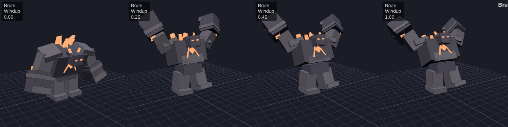
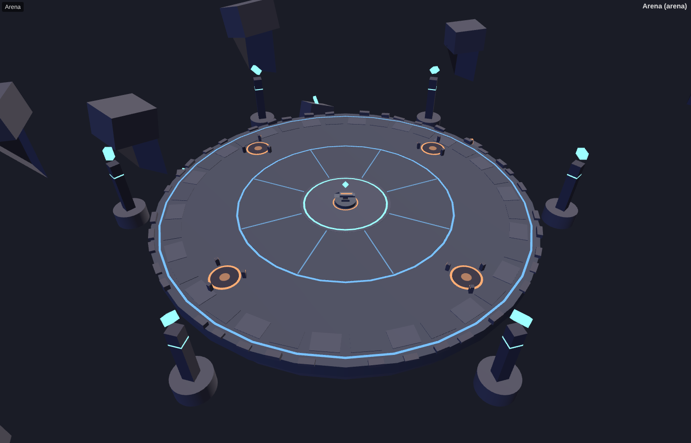

# Aether Forge: Phase 1 vertical slice (Roblox)

Action-combat and mining arena roguelite. This first slice has one floating arena, the warrior-smith
with the full core moveset, the Shard Brute enemy, mineable crystals and simple escalating waves.
It exists to get the feel right before adding content.



*Preview images come from my offline renderer (same rig and animation code, simple lighting).
In Roblox it renders with Future lighting, bloom and neon glow.*

## Play it in Studio

1. Download `build/AetherForge.rbxlx`.
2. In Roblox Studio: **File → Open from File…** and pick it.
3. Press **Play** (F5). The arena, character and lighting are built by scripts when the game starts,
   so the place looks empty in edit mode. That is expected.
4. To keep it in your account: **File → Publish to Roblox**.

To try co-op, use **Test → Clients and Servers** with 2 players.

## Controls

| Input | Mouse + keyboard | Gamepad | Touch |
|---|---|---|---|
| Light combo (3 hits, the 3rd is a spin) | Left click | X | Slash button |
| Heavy Slam | Right click | Y | Slam button |
| Dash (i-frames, cancels light attacks) | Space or Shift | A | Dash button |
| Parry (press when the enemy flashes) | F | B or RB | Parry button |
| Move / aim | WASD + mouse cursor | Left stick | Thumbstick |
| Zoom | Mouse wheel | | |
| Hide controls hint | H | | |
| Tuning panel (Studio only) | T | | |

Attacks aim at your cursor and snap to the nearest enemy (or crystal) inside a cone.

## What's in the slice

**Moves** (frame data in `src/shared/Moves.luau`):

| Move | Startup → active | Total | Notes |
|---|---|---|---|
| Light 1 / Light 2 | 0.065 → 0.15s | 0.34s | Right-to-left slash, then backhand. Chains at 0.16s. A dash can cancel them at any frame. |
| Light 3 | 0.13 → 0.27s | 0.56s | Hopping 360° spin. Big knockback, ends the combo. |
| Heavy Slam | 0.40 → 0.47s | 0.92s | Two-handed overhead slam. Shatters crystals in one hit, interrupts enemy windups, launches enemies (knock them off the edge for a RING OUT). |
| Dash | i-frames 0 → 0.21s | 0.27s | Afterimages, squash and stretch. You can attack out of it after 0.14s. |
| Parry | active 0 → 0.17s | 0.46s | Success: freeze, slow-motion, gold sparks, the enemy is stunned for 1.7s, and you get ×1.5 damage for 1.6s (riposte). A whiffed parry is punishable. |

**Game feel layers:** hitstop on every hit (the attacker and the enemy freeze together), trauma
camera shake, camera kick toward the hit, FOV punch, slow-motion and color grading on parry, cut-line
flashes, sparks, ground shockwave with cracks, dash afterimages, damage numbers, an input buffer, and
aim assist with a lunge magnet.

**Shard Brute:** chases you, then telegraphs each attack: a ground zone that fills up, its body glows
molten, and a white glint flashes about 0.38s before impact. Parry on the glint, dash through it, or
hit it with a Heavy Slam to interrupt it. Light hits don't interrupt a windup.

**Mining:** 3 crystal nodes at a time. Light hits chip them and the Heavy Slam shatters them. Ore
flies into you and the counter goes up. The anvil in the center is where forging goes in Phase 2.

**Waves:** wave N spawns N Brutes (up to 7), each with more HP and faster windups. You heal between
waves. If everyone goes down, the run resets.






## How to playtest (and what to tell me)

1. **Combo:** do Light ×3 on a Brute. Does each hit feel weighty? Is the freeze on hit too long or too
   short?
2. **Cancel:** do Light, Light, then dash away mid-swing. Then dash in and attack straight out of it.
3. **Parry:** wait for the white glint and press F. Then do a riposte combo while the Brute is stunned.
4. **Heavy:** slam a crystal (one hit). Slam a Brute in the middle of its windup (it gets
   interrupted). Slam one near the edge (RING OUT).
5. **Movement:** does walking and turning feel responsive? Is the camera too close, too far or too
   shaky?

Press **T** for the tuning panel: change any value live, toggle slow-mo ×0.25 to watch the animations
closely, show hitboxes, pause waves, make enemies passive (combo practice), spawn Brutes, God mode.
**Print values to Output** dumps your tuned numbers, so you can paste them to me or into
`Config.luau`.

If anything errors, copy the red text from Studio's **Output** window and send it to me.

## Where to change things

| Want to change… | File |
|---|---|
| Hitstop, shake, slow-mo, aim assist, camera, HP, enemy stats, waves | `src/shared/Config.luau` |
| Move timings, damage, knockback, hitboxes, cancel windows | `src/shared/Moves.luau` |
| Animations (keyframes: hand positions, blade direction, body angles) | `src/shared/Clips.luau` |
| Character / enemy / weapon models | `src/shared/Rigs.luau` |
| Arena layout | `src/shared/ArenaLayout.luau` |
| Sounds | `src/client/Sfx.luau` |

**Sounds are the next big upgrade.** The placeholders are sounds built into Roblox (sword slash,
thud, ping). Pick impact, swing, parry and crystal sounds from the Creator Store (many are free and
uploaded by Roblox) and paste their ids into `Sfx.luau`.

## How it is built

```
src/shared/     ReplicatedStorage.AetherForge (used by server and client)
  Config, Moves          tuning and frame data
  Rigs, RigBuilder       geometric models -> Parts + Motor6Ds
  AnimCore, Clips        procedural animation: keyframes + two-bone IK for legs, arms and wrist
  ArenaLayout            the arena as data
  Net                    RemoteEvents
src/server/     ServerScriptService.AetherForgeServer
  ArenaBuilder, CharacterService, EnemyService (AI + strike resolution),
  CombatService (validates hits/parries), CrystalService, WaveService
src/client/     StarterPlayerScripts.AetherForgeClient
  Combat (move state machine), RigAnimator, CameraRig, Effects, EnemyViews (telegraphs, glint,
  hit flash), Hud, Input, Clock (hitstop/slow-mo), OtherPlayers, TuningPanel, Sfx
src/character/  overrides Roblox's default Animate/Health scripts
```

- **No animation assets needed.** Every animation is keyframes plus IK, applied by code
  (`Motor6D.Transform`). Feet stay planted during lunges, both hands grip the hilt on the slam, and the
  wrist aims the blade exactly. Nothing has to be uploaded.
- **Responsive combat with server checks.** Your client decides hits, parries and dodges instantly
  (no input lag). The server checks every claim (range, swing rate, parry/dash timestamps) before
  applying it.
- **Co-op ready:** enemies, waves and damage run on the server, and other players' moves are
  animated on every client.

**Optional workflow with Rojo:** the project is a standard [Rojo](https://rojo.space) project.
`rojo serve` live-syncs the files into Studio, and `rojo build default.project.json -o
build/AetherForge.rbxlx` rebuilds the place. If you edit scripts directly in Studio instead, that's
fine. Tell me what you changed.

`tools/preview/` is the offline renderer I use to check poses and the arena without Studio. You don't
need it to play.

## Roadmap

- **Phase 1 (this):** vertical slice. You playtest, we tune feel over 1–2 rounds, and swap in real
  sounds.
- **Phase 2, the forge loop:** interact with the anvil between waves, smelt ore, and pick 1 of 3
  upgrades from a pool of about 8 (e.g. "3rd hit fires a shockwave", "dash leaves a burning trail",
  "parry calls lightning"). The weapon changes visibly (Ember Blade → Flame Greatsword / Storm
  Hammer). Fire, Lightning and Ice crystals spawn in risky spots. Endless waves and a run summary
  screen.
- **Phase 3, enemy variety:** a ranged caster, a fast flanker and a shielded enemy, plus a boss every
  5 waves with multi-attack patterns.
- **Phase 4, ship it:** DataStore saves and meta progression, lobby and co-op scaling, mobile UI
  polish, online-latency polish for enemy knockback, and publishing.

## Known limits of this build

- This code was written and checked outside Roblox: linted, Roblox API names checked against
  Roblox's type definitions, and the animation system unit-tested. It has **not** been run in Studio
  yet, so expect a few small fixes after your first playtest.
- Online, enemy knockback lags behind the hit by your ping (it's instant in Studio). That's planned
  for Phase 4.
